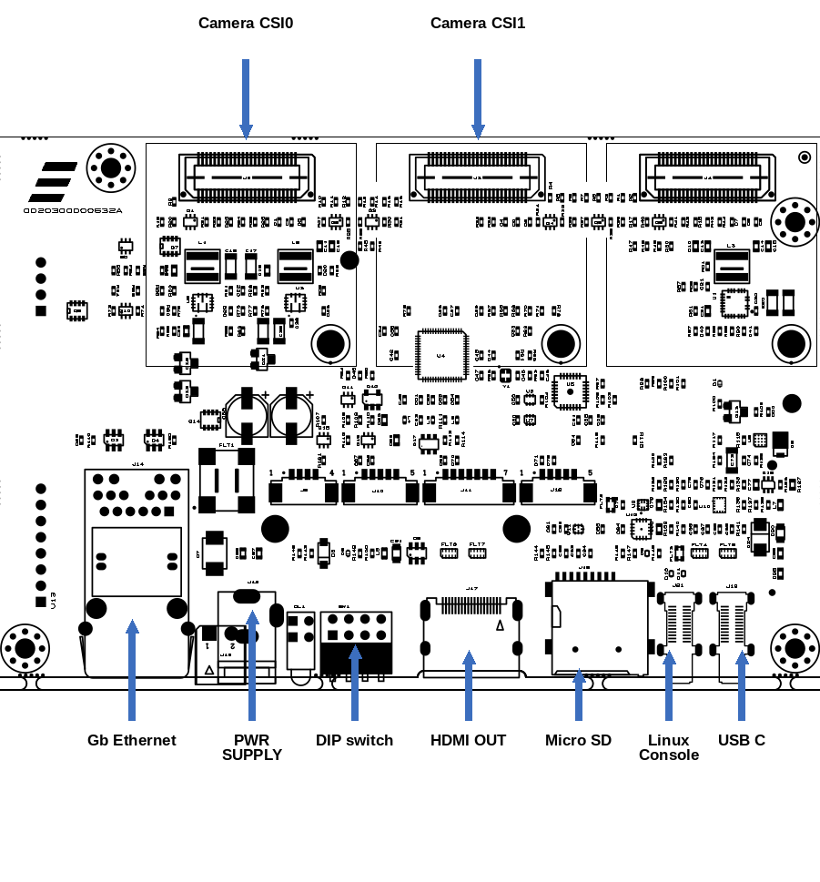
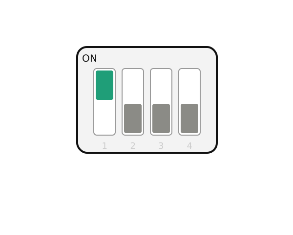
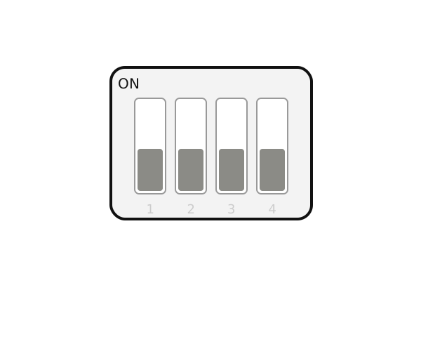
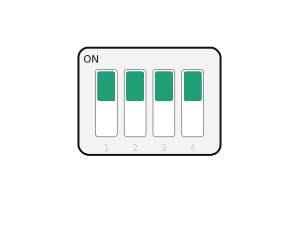

# Test Sheet: Tia Genio 720 Camera Board

## Version: 1.0

## Linux Console

| Console       | Baud Rate |
| :------------ | :-------- |
| Linux Console | 921600    |

---

## Board Type: Tia Camera Board
## SOM Type: Tia Genio 720



---

## U-Boot Tests

| Test | Status |
| :--- | :----: |
| [UFS Environment Saving](#ufs-environment-saving) | OK |
| [eMMC Environment Saving](#emmc-environment-saving) | OK |
| [NORBOOT Environment Saving](#norboot-environment-saving) | OK |
| [Ethernet](#ethernet) | TBT |
| [Boot from UFS or eMMC](#boot-from-ufs-or-emmc) | OK |
| [Boot from NORBOOT](#boot-from-norboot) | OK |
| [Serial Download](#serial-download) | OK |

## Test Notes

### UFS Environment Saving
```bash
setenv serverip 192.168.2.93
saveenv                     
# Saving Environment to scsi... Writing to SCSI device(1)... OK
reset board
printenv serverip
```

### eMMC Environment Saving
```bash
setenv serverip 192.168.2.93
saveenv                     
# Saving Environment to MMC... Writing to MMC(0)... OK
reset board
printenv serverip
```

### NORBOOT Environment Saving
```bash
setenv serverip 192.168.2.93
saveenv
# Saving Environment to SPIFlash... Erasing SPI flash...Writing to SPI flash...done
reset board
printenv serverip
```

### Boot from UFS or eMMC


### Boot from NORBOOT


### Serial Download


Set `SW1` to enable serial download. Connect the board to the host machine using the board's OTG header `J18`. Power on the board and execute:

```bash
genio-flash -i rity-demo-image
```

---

## Linux Kernel Tests

| Status | Test                | Note |
| :----: | :------------------ | :--- |
| OK | Ethernet (J14)      | See [Note 1](#note-1-ethernet-verification) |
| OK | SDCARD              | See [Note 2](#note-2-sd-card-detection) |
| OK | Linux Console (J21) | |
| OK | RTC                 | See [Note 3](#note-3-rtc-initialization) |
| OK | Reboot              | |
| OK | HDMI                | |
| OK | M.2 Key M PCIe      | See [Note 4](#note-4-pci-device-verification-lspci) |
| OK | MIPI-CSI (J2)       | See [Note 5](#note-5-mipi-csi-camera-test-j2-interface) |
| OK | MIPI-CSI (J3)       | See [Note 6](#note-6-mipi-csi-camera-test-j3-interface) |
| OK | USB-C (J18)         | See [Note 7](#note-7-usb-c-j18) |


---

## Notes

### Note 1: Ethernet Verification
Connect the board's Ethernet port to your host machine.

On the host machine, start the `iperf3` server:
```bash
iperf3 -s
```

On the board, launch `iperf3` in client mode using the host machine's IP address:
```bash
iperf3 -c 10.24.1.74
```

**Expected Output:**
```text
Connecting to host 10.24.1.74, port 5201
[  5] local 10.24.67.160 port 34174 connected to 10.24.1.74 port 5201
[ ID] Interval           Transfer     Bitrate         Retr  Cwnd
[  5]   0.00-1.00   sec   113 MBytes   950 Mbits/sec   18    229 KBytes       
[  5]   1.00-2.00   sec   112 MBytes   941 Mbits/sec    9    276 KBytes       
[  5]   2.00-3.00   sec   110 MBytes   925 Mbits/sec   88    212 KBytes       
[  5]   3.00-4.00   sec   112 MBytes   942 Mbits/sec   18    219 KBytes       
[  5]   4.00-5.00   sec   111 MBytes   931 Mbits/sec    9    356 KBytes       
[  5]   5.00-6.00   sec   112 MBytes   938 Mbits/sec    9    287 KBytes       
[  5]   6.00-7.00   sec   111 MBytes   931 Mbits/sec    9    262 KBytes       
[  5]   7.00-8.00   sec   111 MBytes   934 Mbits/sec    9    274 KBytes       
[  5]   8.00-9.00   sec   112 MBytes   938 Mbits/sec    9    270 KBytes       
[  5]   9.00-10.01  sec   112 MBytes   927 Mbits/sec    6    344 KBytes    
- - - - - - - - - - - - - - - - - - - - - - - - -
[ ID] Interval           Transfer     Bitrate         Retr
[  5]   0.00-10.01  sec  1.09 GBytes   936 Mbits/sec  184            sender
[  5]   0.00-10.02  sec  1.09 GBytes   934 Mbits/sec                  receiver

iperf Done.
```

### Note 2: SD Card Detection
Verify SD card detection logs via kernel output:
```text
mmc1: host does not support reading read-only switch, assuming write-enable
mmc1: new high speed SDHC card at address 2145
mmcblk1: mmc1:2145  29.1 GiB
 mmcblk1: p1 p2 
```

### Note 3: RTC Initialization
Set the system time and date, then write it to the hardware clock:
```bash
date -s "2026-08-20 11:35:00"
hwclock -w -f /dev/rtc0
```
Power cycle the board. Once booted, verify that the hardware clock retained the correct date and time:
```bash
hwclock -r -f /dev/rtc0
```

### Note 4: PCI Device Verification (`lspci`)
To verify the connected hardware on the PCI bus, run the following command:
```bash
lspci
```

**Expected Output:**
```text
00:00.0 PCI bridge: MEDIATEK Corp. Device 8189 (rev 01)
01:00.0 Non-Volatile memory controller: Innodisk Corporation PCIe 3TE6 Controller (DRAM-less) (rev 01)
```


### Note 5: MIPI-CSI Camera Test (J2 Interface)
Configure and initialize the camera sensor connected to the J2 interface slot:
```bash
export MEDIA_DEV=$(v4l2-ctl -z platform:$(basename `find /sys/bus/platform/devices/ -name "*seninf-top"`) --list-devices | grep media)

declare -a VIDEO_DEV=($(for i in `find /sys/bus/platform/devices/ -name "*camsv*" | sort`; do media-ctl -d ${MEDIA_DEV} --entity "`basename $i` video stream" ; done))

media-ctl -d ${MEDIA_DEV} -l "'ov5640 7-003c':0 -> 'seninf-0':0 [1]"
media-ctl -d ${MEDIA_DEV} -l "'seninf-0':1 -> '1a092000.camsv2':0 [1]"
media-ctl -d ${MEDIA_DEV} -V "'ov5640 7-003c':0 [fmt:YUYV8_1X16/1920x1080 field:none]"
media-ctl -d ${MEDIA_DEV} -V "'seninf-0':1 [fmt:YUYV8_1X16/1920x1080 field:none]"
media-ctl -d ${MEDIA_DEV} -V "'1a092000.camsv2':1 [fmt:YUYV8_1X16/1920x1080 field:none]"

gst-launch-1.0 v4l2src device=${VIDEO_DEV[0]} ! video/x-raw,width=1920,height=1080,format=YUY2 ! v4l2convert output-io-mode=dmabuf-import ! video/x-raw,width=1280,height=720 ! fpsdisplaysink video-sink=waylandsink sync=false
```

### Note 6: MIPI-CSI Camera Test (J3 Interface)
Configure and initialize the camera sensor connected to the J3 interface slot:
```bash
export MEDIA_DEV=$(v4l2-ctl -z platform:$(basename `find /sys/bus/platform/devices/ -name "*seninf-top"`) --list-devices | grep media)

declare -a VIDEO_DEV=($(for i in `find /sys/bus/platform/devices/ -name "*camsv*" | sort`; do media-ctl -d ${MEDIA_DEV} --entity "`basename $i` video stream" ; done))

media-ctl -d ${MEDIA_DEV} -l "'ov5640 8-003c':0 -> 'seninf-1':0 [1]"
media-ctl -d ${MEDIA_DEV} -l "'seninf-1':1 -> '1a093000.camsv3':0 [1]"
media-ctl -d ${MEDIA_DEV} -V "'ov5640 8-003c':0 [fmt:YUYV8_1X16/1920x1080 field:none]"
media-ctl -d ${MEDIA_DEV} -V "'seninf-1':1 [fmt:YUYV8_1X16/1920x1080 field:none]"
media-ctl -d ${MEDIA_DEV} -V "'1a093000.camsv3':1 [fmt:YUYV8_1X16/1920x1080 field:none]"

gst-launch-1.0 v4l2src device=${VIDEO_DEV[1]} ! video/x-raw,width=1920,height=1080,format=YUY2 ! v4l2convert output-io-mode=dmabuf-import ! video/x-raw,width=1280,height=720 ! fpsdisplaysink video-sink=waylandsink sync=false
```
### Note 7: USB-C (J18) 

HOST: use usb-c hub with usb stick 

```
[  497.022144] usb 1-1.3: new high-speed USB device number 7 using xhci-mtk
[  497.147629] usb-storage 1-1.3:1.0: USB Mass Storage device detected
[  497.149571] scsi host1: usb-storage 1-1.3:1.0
[  498.175010] scsi 1:0:0:0: Direct-Access     Intenso  Rainbow Line     5.20 PQ: 0 ANSI: 2
[  498.180403] sd 1:0:0:0: [sdd] 30720000 512-byte logical blocks: (15.7 GB/14.6 GiB)
[  498.182680] sd 1:0:0:0: [sdd] Write Protect is off
[  498.183900] sd 1:0:0:0: [sdd] No Caching mode page found
[  498.184589] sd 1:0:0:0: [sdd] Assuming drive cache: write through
[  498.203746]  sdd: sdd1 sdd2 sdd3 sdd4                      
[  498.204893] sd 1:0:0:0: [sdd] Attached SCSI removable disk 
```

DEVICE: use ethernet gadget with mediatek

```
usb0: flags=4163<UP,BROADCAST,RUNNING,MULTICAST>  mtu 1500                              
        inet 192.168.96.1  netmask 255.255.255.0  broadcast 192.168.96.255
        inet6 fe80::a4d9:45a6:4554:f54  prefixlen 64  scopeid 0x20<link>
        ether 0a:c7:0d:37:1e:23  txqueuelen 1000  (Ethernet)       
        RX packets 123  bytes 13919 (13.5 KiB)                     
        RX errors 0  dropped 0  overruns 0  frame 0                
        TX packets 174  bytes 27768 (27.1 KiB)                     
        TX errors 0  dropped 0 overruns 0  carrier 0  collisions 0

PC HOST:

ping -c 5 192.168.96.1
PING 192.168.96.1 (192.168.96.1) 56(84) bytes of data.
64 bytes from 192.168.96.1: icmp_seq=1 ttl=64 time=0.250 ms
64 bytes from 192.168.96.1: icmp_seq=2 ttl=64 time=0.293 ms
64 bytes from 192.168.96.1: icmp_seq=3 ttl=64 time=0.246 ms
64 bytes from 192.168.96.1: icmp_seq=4 ttl=64 time=0.301 ms
64 bytes from 192.168.96.1: icmp_seq=5 ttl=64 time=0.241 ms

--- 192.168.96.1 ping statistics ---
5 packets transmitted, 5 received, 0% packet loss, time 4107ms
rtt min/avg/max/mdev = 0.241/0.266/0.301/0.025 ms
```

